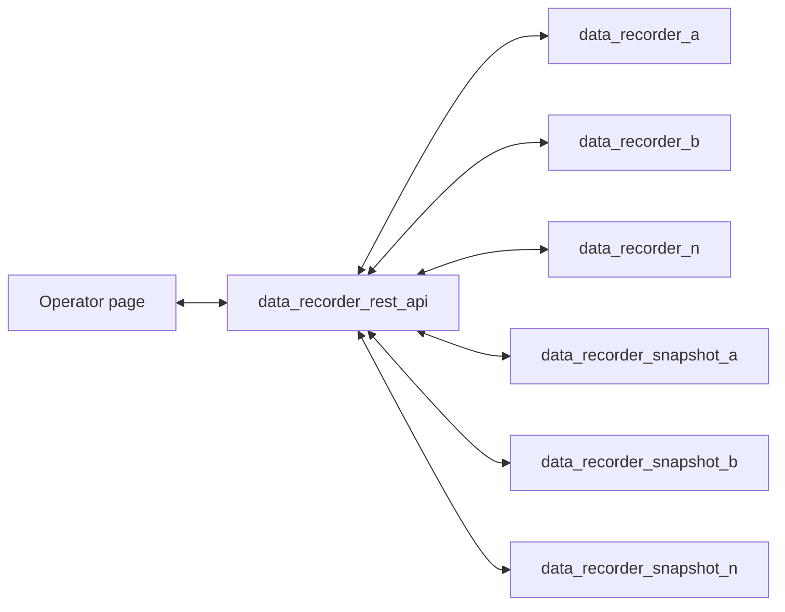

# data_recorder

`data_recorder` controls ROS 2 bag recording and provides the interface to operate it. Commands go through ROS 2 services and a REST API. Each recorder is configured with the topics to record, optional expected rates, split limits, compression, and whether recording starts automatically when the node starts. While a recording is active, the node monitors free disk space and topic rates and publishes that state as diagnostics.



Communication runs in both directions: commands, diagnostics, and configuration. `data_recorder_a` through `data_recorder_n` are the continuous recorders. `data_recorder_snapshot_a` through `data_recorder_snapshot_n` are the snapshot recorders. Each one is named in `data_recorder_rest_api.param.yaml`.

Launch:

```bash
ros2 launch data_recorder data_recorder.launch.xml
ros2 launch data_recorder data_recorder.launch.xml autostart_recording:=true output_directory:=/data/bags
ros2 launch data_recorder data_recorder_snapshot.launch.xml output_directory:=/data/bags
ros2 launch data_recorder data_recorder_rest_api.launch.xml
```

`output_directory` defaults to `$HOME`. `prefix` is the bag name stem. It is a launch argument, `continous` for continuous recording and `snapshot` for snapshot recording. It is not in the parameter YAML. A continuous folder is named once, when recording starts: `<prefix>_<timestamp>` inside `output_directory`. That name stays until stop. Change the continuous prefix with `rqt_reconfigure` or `POST /recording/<name>/prefix?prefix=NAME` only while recording is stopped. A snapshot prefix is fixed by the launch file. The snapshot node does not accept dynamic reconfigure. `autostart_recording` defaults to `false` and applies to continuous recording. Set it to `true` to start that recording when the node starts. A snapshot node arms its buffer on startup and keeps it armed. `output_directory` must already exist.

Each launch starts one recorder. `node_name` defaults to `data_recorder` or `data_recorder_snapshot`. Pass another `node_name` to run a second continuous or snapshot recorder. Each node has its own services under `/system/<node_name>/`: `start_recording`, `stop_recording`, and `snapshot`. The REST API is `/system/data_recorder_rest_api`, started by `data_recorder_rest_api.launch.xml`, on port `8080`.

## Modes

**continuous.** `data_recorder.launch.xml` and `data_recorder.param.yaml`. `start_recording` opens a bag and writes until `stop_recording`. `split_size_mb` and `split_duration_s` roll the bag into a new file. `0` disables that limit. `min_free_disk_mb` stops the recording when free space on `output_directory` falls below that many megabytes. `0` disables the stop. A start while already below the limit is rejected.

**snapshot.** `data_recorder_snapshot.launch.xml` and `data_recorder_snapshot.param.yaml`. When the node starts it creates one folder, `<output_directory>/<prefix>_<timestamp>`, and arms a RAM ring buffer of `snapshot_cache_mb` megabytes. Messages stay in RAM. The folder holds the open MCAP from the start. `snapshot` waits `snapshot_post_trigger_s` seconds (default 10), then writes the RAM buffer into that same folder. The wait is what puts data from after the trigger into the bag. `0` stores the buffer immediately. Each later trigger adds another MCAP in the same folder and writes `topic_rates.csv` there. The RAM buffer is cleared by that write and then fills again, so a later trigger stores only messages received after the previous write. A second trigger during the wait is rejected. `stop_recording` does not disarm the buffer. Stopping the node discards whatever is still only in RAM. Jazzy bounds this buffer by size, not by time.

## Services

```text
/system/data_recorder/start_recording              std_srvs/Trigger
/system/data_recorder/stop_recording               std_srvs/Trigger
/system/data_recorder/snapshot                     std_srvs/Trigger
/system/data_recorder_snapshot/start_recording     std_srvs/Trigger
/system/data_recorder_snapshot/stop_recording      std_srvs/Trigger
/system/data_recorder_snapshot/snapshot            std_srvs/Trigger
```

`snapshot` fails in continuous mode. Every continuous stop runs the rate check, including a service stop, the free-disk stop, and Ctrl-C. Ctrl-C closes the bag and writes the rate file before the process exits. A snapshot runs the same check when the bag is stored. Topics that declared an expected rate are compared with `tolerance_topic_rate`. The stop response is a failure when a checked topic is outside that range. The bag is still kept. Results are written to `topic_rates.csv` in the bag directory.

## Parameters


| Parameter                 | Role                                                                                                                  |
| ------------------------- | --------------------------------------------------------------------------------------------------------------------- |
| `output_directory`        | Existing directory for bags                                                                                           |
| `prefix`                  | Bag name stem, set by the launch file. Empty becomes `rosbag2`. Continuous: change it while recording is stopped. Snapshot: fixed at launch |
| `use_timestamp`           | Append `_YYYY_MM_DD-HH_MM_SS`                                                                                         |
| `record_all`              | `true` records every topic. `false` records `topics`                                                                  |
| `topics`                  | `/foo` or `/foo:100`. The number is the expected Hz                                                                   |
| `tolerance_topic_rate`    | Allowed deviation in percent. Default `5`                                                                             |
| `transient_local_topics`  | Latched topics rewritten at each split and into each snapshot                                                         |
| `split_size_mb`           | Default continuous config. `0` disables size splitting                                                                |
| `split_duration_s`        | Default continuous config. `0` disables duration splitting                                                            |
| `min_free_disk_mb`        | Default continuous config. Stop recording below this free space, in MB. `0` disables                                  |
| `compression`             | Apply `mcap_config_file` when true                                                                                    |
| `mcap_config_file`        | MCAP writer options. The launch file fills this in                                                                    |
| `mode`                    | `continuous` in the default launch, `snapshot` in the snapshot launch                                                 |
| `snapshot_cache_mb`       | Snapshot config only. Required above `0`                                                                              |
| `snapshot_post_trigger_s` | Snapshot config only. Seconds to wait after a trigger before storing the buffer. Default `10`. `0` stores immediately |
| `autostart_recording`     | Continuous only. Start when the node starts. Default `false`. Snapshot always arms on startup                         |
| `publish_state_rate`      | Diagnostics rate in Hz. `0` disables publishing                                                                       |


A continuous recorder accepts `ros2 param set` and `rqt_reconfigure` while recording is stopped. A snapshot recorder does not accept parameter changes after it has started.

## Status

`/system/data_recorder/diagnostics` and `/system/data_recorder_snapshot/diagnostics` (`diagnostic_msgs/DiagnosticArray`) report whether recording is active, the mode, the bag directory, free disk space (`FreeDiskMB`), and the last rate check. A continuous recording also reports the stop limit (`MinFreeDiskMB`), `RecordingStarted`, and `RecordingDuration` (`HH:MM:SS`) while it is running. A snapshot recording reports `LastTrigger`, the time the trigger was called. Free space is the space available on `output_directory`. Each of those two launch files relays its diagnostics topic to `/diagnostics` with `topic_tools`.

`recording_state` (`std_msgs/Bool`) on each node is the same active flag.

## REST API

`/system/data_recorder_rest_api` is the only REST node. Start it with `data_recorder_rest_api.launch.xml`. `data_recorder_rest_api.param.yaml` lists each recorder as `url_name:/namespace/node_name`. Names in `continuous` accept start and stop. Names in `snapshot` accept the snapshot trigger. Boost.Beast serves HTTP, from `libboost-dev` on Ubuntu 24.04, on all interfaces (`0.0.0.0`) at port `8080`.

| Method    | Path                                           | Action                                                       |
| --------- | ---------------------------------------------- | ------------------------------------------------------------ |
| GET, POST | `/recording/data_recorder/start`              | start that continuous recorder                               |
| GET, POST | `/recording/data_recorder/stop`               | stop that continuous recorder                                |
| GET       | `/recording/data_recorder/status`             | status of that recorder                                      |
| GET, POST | `/recording/snapshot/trigger`                  | store that snapshot buffer                                   |
| GET       | `/recording/snapshot/status`                   | status of that snapshot recorder                             |
| GET       | `/recording/nodes`                             | recorders whose node is currently running                    |
| GET       | `/recording/status`                            | status of every configured recorder                          |
| GET       | `/recording/data_recorder/storage`            | output directory, prefix, mode, current bag                  |
| GET, POST | `/recording/data_recorder/prefix?prefix=NAME` | set the continuous prefix for the next start. Rejected while recording, and rejected for a snapshot recorder |
| GET       | `/recording/data_recorder/disk`               | capacity and free space for that recorder's output directory |


Replace `data_recorder` or `snapshot` with the URL name from the YAML list. A completed service call returns HTTP 200. The JSON field `success` is the recorder result. HTTP 503 means the recorder is not up. HTTP 504 means the service call timed out.

```bash
curl -X POST http://127.0.0.1:8080/recording/data_recorder/start
curl http://127.0.0.1:8080/recording/data_recorder/status
curl http://127.0.0.1:8080/recording/nodes
curl http://127.0.0.1:8080/recording/status
curl -X POST http://127.0.0.1:8080/recording/snapshot/trigger
curl http://127.0.0.1:8080/recording/snapshot/status
```

## Website

The operator page is the static files `www/index.html`, `www/app.js`, and `www/style.css`. The REST service does not serve those files.

The page lists the recorders that are running and refreshes them every 2 seconds. A continuous card shows whether recording is active, one control that reads Start while stopped and Stop while recording, the start time, the time since start, the free disk space, the MCAP split size, the MCAP split time, and the directory. A split limit of `0` is shown as `-`. The start time and the time since start are `-` while recording is stopped. A snapshot card shows the last trigger, the last snapshot, the free disk space, the directory, and a Trigger control. Show topics lists the configured topics and Hide topics closes that list. When a command is rejected, the rate check fails, free disk space is below the minimum, or the directory is not available, the card shows Error with the recorder reason beside it. A failed rate check also lists the topics that failed.

The API address is the field at the top of the page. When none is stored, or a stored address is `127.0.0.1` and the page was opened on another host, the field uses that host on port `8080`. The address is kept in the browser for the next open.

The page can be served from its own container. That image contains only the static files. It does not start a recorder: the topic list, the output directory, and the ROS graph stay in the parameter YAML on the machine that records.

```bash
docker compose up --build
```

Run that from the `docker` directory. The host port is `WEBSITE_PORT` in `docker/compose.yaml` and defaults to `8081`. Open `http://<this-host>:8081` from a phone on the same network. The API field uses that same host on port `8080`, so the IP does not have to be typed. A saved `127.0.0.1` is replaced by that host. Port `8081` is only the page. Port `8080` stays the REST API.

